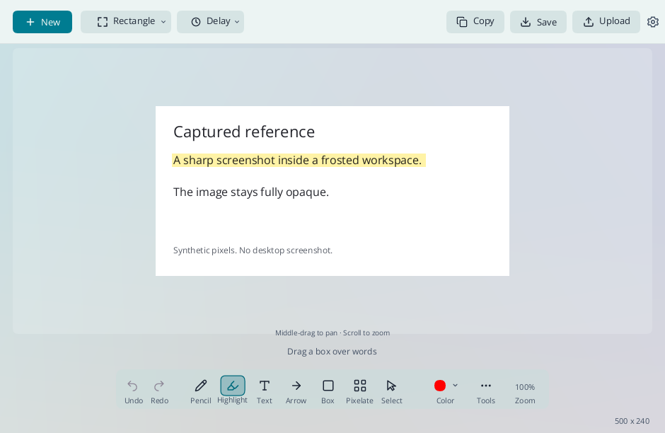
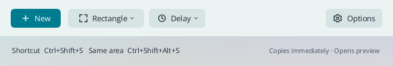
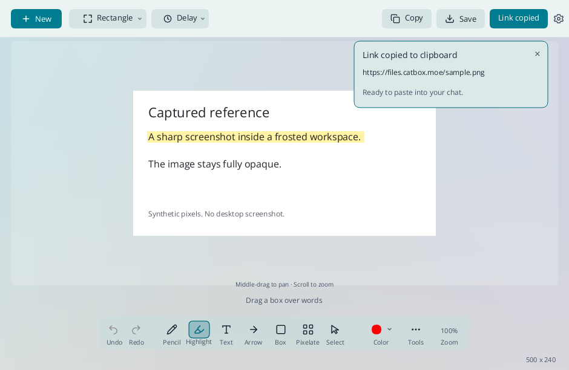

<p align="center"></p>

<h1 align="center">Snipping Tool UL</h1>
<p align="center"><strong>Ultralight in performance, not features.</strong><br>A lightweight native Rust snipping tool for Windows 11.</p>

<p align="center"><a href="https://github.com/finalpantasy/Snipping-Tool-Ultralite/releases/download/v0.3.21-preview/Snipping-Tool-UL-0.3.21-Windows-x64.zip"><strong>Download Windows preview</strong></a> · <a href="docs/USAGE.md">User guide</a> · <a href="LICENSE">MIT license</a></p>



Take a snip. It is copied immediately, and the preview opens automatically. Paste it into a conversation or keep editing without another button click.

**Native Rust. No webview. No permanent render loop.** Teal frosted controls, a themed title bar, and light mode by default, with optional dark mode.

## The essentials, within reach

| Capture | Edit | Keep and share |
| --- | --- | --- |
| Region, window, full screen | Pencil, arrows, shapes, highlights | Immediate image clipboard copy |
| Frozen snapshot during selection | Text, pixelation, numbered steps | Save at original resolution |
| Configurable hotkeys | Live width and size controls | Explicit one-click public image links |
| 3, 5 or 10-second timers | Undo, redo, pointer-centered zoom | Optional history and auto-save |
| Windows Start integration | Middle-mouse pan, local OCR | Pin screenshots on screen |

Catbox, Freeimage.host and temporary Litterbox sharing need no account or personal API key. Uploading is an explicit action, with an optional confirmation and five-second cooldown. An unchanged image reuses its recent successful link. These are public links; [read the hosting details](docs/UPLOAD-HOSTS.md).

<details>
<summary>Home keeps capture controls together</summary>



*The launcher keeps capture controls and the screenshot shortcut visible without a large blank canvas.*

</details>

<details>
<summary>Upload shows progress and tells you when the link is ready</summary>



*The button shows progress, then confirms **Link copied**. If copying fails, **Copy link** retries using the existing upload.*

</details>

## Start using it

1. [Download the Windows x64 ZIP](https://github.com/finalpantasy/Snipping-Tool-Ultralite/releases/download/v0.3.21-preview/Snipping-Tool-UL-0.3.21-Windows-x64.zip) and extract it.
2. Launch `snipping-tool-ul.exe`.
3. Choose **New** or press **Ctrl+Shift+S**.

Portable use needs no installer. **Options > Quit Snipping Tool UL** exits completely. Choose **Keep in tray** or **Quit completely** for the X button in Settings. History and auto-save are off by default.

Optional **Settings > Windows > Use as my Snipping Tool** installs for your account and can replace Microsoft's Snipping Tool entry in Start. The installer explains and confirms the replacement. Windows' reserved Win+Shift+S shortcut is not remapped. [Setup and usage guide](docs/USAGE.md)

## Small by design, measured honestly

| Measured component | Result |
| --- | --- |
| Local OCR | 17 ms for small text; 48 ms for dense 1080p; 212 ms for dense 4K |
| OCR invocation improvement | Earlier paired tests: 3.6-33x faster than UL's previous PowerShell path |
| History thumbnails | 98.9-99.7% lower peak Rust heap allocation at 4K/8K |
| Original-resolution History copy | Approximately half the previous image heap peak |
| Annotated pan / pixelation-heavy zoom | 22% / 28% less renderer processing time |

Two 1,000-call native 4K OCR traces kept live Rust allocations and OS handles flat after warm-up. Windows cache memory still fluctuates. These are generated-image component tests; heap allocation and committed memory are not total physical RAM, and renderer timings are not complete UI latency.

**Microsoft's stock Snipping Tool has not been benchmarked directly.** The measured gains compare UL with its earlier implementations. [Performance results, methods and stock-comparison status](docs/PERFORMANCE.md)

**0.3.21 is a preview.** The release passed 328 automated tests, plus native OCR lifecycle checks. Broader native workflows, mixed-monitor acceptance, live image-host uploads and a full interactive leak soak remain open. [Release verification](docs/VERIFICATION-0.3.21.md)

## Build and contribute

Windows MSVC Rust toolchain, Rust 1.89 or newer:

```powershell
cargo fmt --all -- --check
cargo test --locked
./scripts/Test-CurrentUserIntegration.ps1
./scripts/Build-Portable.ps1
```

Portable builds remap machine-specific build paths. Tests use generated content; native GUI checks require isolation or explicit user authorization. Please include your Windows version, display scale and a reproducible sequence in [bug reports](https://github.com/finalpantasy/Snipping-Tool-Ultralite/issues).

This standalone project derives from MIT-licensed [HydroShot](https://github.com/Real-Fruit-Snacks/HydroShot). Required attribution is preserved in [LICENSE](LICENSE) and [third-party notices](THIRD_PARTY_NOTICES.md).
