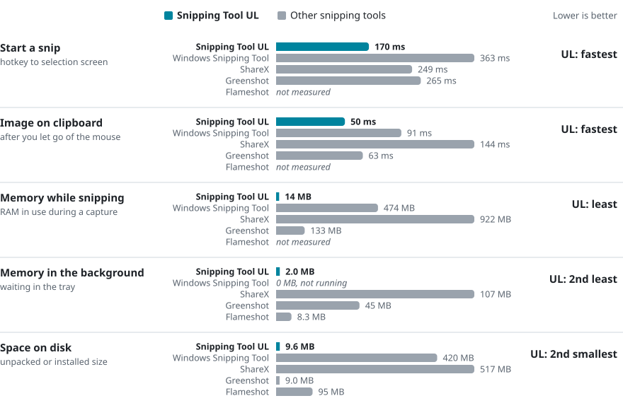

<p align="center"></p>

<h1 align="center">Snipping Tool UL</h1>

<p align="center"><b>A faster, lighter Snipping Tool for Windows 11.</b><br>Snip it, mark it up, paste it. Free and open source.</p>

<p align="center">
  <a href="https://github.com/finalpantasy/Snipping-Tool-Ultralite/releases"></a>
  <a href="https://github.com/finalpantasy/Snipping-Tool-Ultralite/actions/workflows/ci.yml"></a>
  
  
  
  <a href="LICENSE"></a>
</p>

<p align="center">
  <a href="https://github.com/finalpantasy/Snipping-Tool-Ultralite/releases/download/v0.3.25-preview/Snipping-Tool-UL-0.3.25-Windows-x64.zip"><b>Download for Windows</b></a>
  &nbsp;·&nbsp; <a href="docs/USAGE.md">User guide</a>
  &nbsp;·&nbsp; <a href="CHANGELOG.md">What's new</a>
</p>


## Why use it

- **It's quick.** Press <kbd>Ctrl</kbd>+<kbd>Shift</kbd>+<kbd>S</kbd> and the selection screen is up in about 0.17 seconds. In our tests it was faster than the Snipping Tool built into Windows, ShareX and Greenshot.
- **Your snip is ready the moment you let go.** It's already on your clipboard, so you can paste it anywhere, and the editor opens by itself in case you want to draw on it.
- **It's tiny.** One 10 MB file. No installer, no account, no ads.
- **It stays out of your way.** When you're not snipping it uses no measurable CPU. While snipping it uses about 15 MB of memory; Windows' own tool uses close to 500 MB and ShareX close to 1 GB.
- **Your screenshots stay on your PC.** A snip only leaves your computer when you press Upload.

## How it compares

<picture>
  <source media="(prefers-color-scheme: dark)" srcset="docs/media/comparison-dark.svg">
  
</picture>

<sub>Snipping Tool UL 0.3.25, Windows Snipping Tool 11.2608.41.0, ShareX 21.0.0, Greenshot 1.3.323 and Flameshot 14.0.0 on the same Windows 11 PC with three 4K monitors, October 14, 2026. 30 test snips per app, typical (median) result shown, every snip checked pixel by pixel. <a href="docs/PERFORMANCE.md">How we measured</a></sub>

Flameshot asks which monitor to use before every snip on a PC with more than one screen, so its snip speed could not be measured the same way.

## What it can do

| Capture | Draw and edit | Share and keep |
| --- | --- | --- |
| Any area, a window or the whole screen | Pen, arrows, boxes, circles, highlighter | Copied to the clipboard automatically |
| Freezes the screen while you choose | Text, numbered steps, blur (pixelate) | Save as a full-quality image |
| 3, 5 or 10 second timer | Undo, redo, zoom in and out | One-click shareable link |
| Pick your own shortcut keys | Draw past the edges and the picture grows | Pin a snip on top of other windows |
| Light and dark mode | Copy the text out of any snip | Optional history and auto-save |

<details>
<summary><b>More screenshots</b></summary>
<br>


</details>

## Get started in 30 seconds

1. [Download the ZIP](https://github.com/finalpantasy/Snipping-Tool-Ultralite/releases/download/v0.3.25-preview/Snipping-Tool-UL-0.3.25-Windows-x64.zip) and unzip it anywhere.
2. Double-click `snipping-tool-ul.exe`.
3. Press <kbd>Ctrl</kbd>+<kbd>Shift</kbd>+<kbd>S</kbd>, drag over what you want, and paste.

That's it. Nothing is installed. To close it completely, use **Options > Quit Snipping Tool UL**.

**Want it in your Start menu?** Open **Settings > Windows > Use as my Snipping Tool**. There's an optional box to replace Microsoft's Snipping Tool; ticking it **uninstalls Microsoft's version** for your account. You can get it back any time from the [Microsoft Store](https://apps.microsoft.com/detail/9mz95kl8mr0l). <kbd>Win</kbd>+<kbd>Shift</kbd>+<kbd>S</kbd> is not changed to open UL.

## Privacy

- No account and no tracking. The app goes online in two cases: when you press **Upload**, and once a week at most to ask GitHub whether a newer version exists. That check sends nothing about you or your snips, never downloads or installs anything, and only shows an "Update available" link. Turn it off in **Settings > General > Check for updates weekly**.
- Uploads go to Catbox, Freeimage.host or Litterbox (expires on its own). Those links are public, so anyone with the link can see the image. [Details](docs/UPLOAD-HOSTS.md)
- History and auto-save are off until you turn them on.
- Copying text out of a snip uses Windows' built-in text recognition, on your PC.

<details>
<summary><b>For the technical crowd</b></summary>
<br>

**How it's built**

- Native Rust drawing straight to Windows (Win32 and GDI). No web view, no Electron, no .NET runtime.
- Event-driven: it sleeps until your hotkey fires. There is no render loop running in the background.
- The screen is frozen the instant you press the hotkey, across every monitor, with per-monitor DPI and negative coordinates handled.
- Snips are copied as a standard bitmap and saved as PNG at full resolution.
- Text recognition calls `Windows.Media.Ocr` directly: about 17 ms for a small snip and 48 ms for a dense 1080p screen.
- 358 automated tests run on every push.

**How the comparison was measured**

- Hardware: one Windows 11 PC with three 3840 x 2160 monitors at 150% scaling.
- Snipping: a script pressed each app's own hotkey and dragged the same 1280 x 720 area over a known test pattern. It then read the result back from the clipboard and checked it pixel by pixel. Both apps ran with their normal settings, and each saved every snip to disk.
- Startup: each app was launched fresh on a hidden desktop so nothing could steal focus.
- Each test: 5 warm-up runs, then 30 measured runs, alternating which app went first.
- Memory figures are private bytes. Raw tables, p95 values and known limits are in [PERFORMANCE.md](docs/PERFORMANCE.md).

**Build it yourself** (Windows, MSVC Rust toolchain, Rust 1.89 or newer)

```powershell
cargo test --locked
./scripts/Build-Portable.ps1
```

</details>

## Status

0.3.25 is a preview release. Not yet verified: monitors with mixed scaling, live uploads to every host, and memory use over very long sessions. [Release checks](docs/VERIFICATION-0.3.25.md)

Found a bug? [Open an issue](https://github.com/finalpantasy/Snipping-Tool-Ultralite/issues) with your Windows version, display scaling and the steps that cause it.

## Credits

Snipping Tool UL is based on the MIT-licensed [HydroShot](https://github.com/Real-Fruit-Snacks/HydroShot). Attribution is kept in [LICENSE](LICENSE) and [third-party notices](THIRD_PARTY_NOTICES.md).
