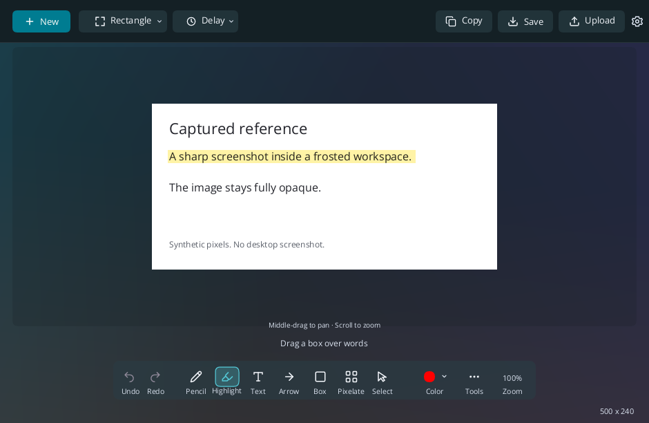

<p align="center"></p>

# Snipping Tool UL

**Ultralight in performance, not features.** A native Rust screenshot tool for Windows 11. Select a region, copy immediately, then annotate in the preview that opens automatically.

Local preview build; GitHub publication is pending. [Verification and limits](docs/VERIFICATION-0.3.8.md)

The editor images below are actual UI code rendered headlessly with synthetic content, not screenshots of a native Windows capture session. Working-media evidence is still required before publication.




## Capture and edit

- Region, window and full-screen capture; configurable hotkeys and 3/5/10-second timers.
- Image clipboard output for pasting into chats. Copy updates annotations without closing the preview.
- Middle-mouse drag pans the image; pointer-centered wheel zoom scales it. Ctrl+0 resets the view. Export keeps the original resolution.
- Smooth pencil strokes, arrows, shapes, word highlights, pixelation, text and numbered steps.
- Live width and size controls: slider, numeric box and minus/plus buttons. Arrowheads scale with width.
- Text uses Open Sans, with a visible size control. Ordinary scrolling stays zoom.
- **Select** (V) selects annotations to move, resize or change; it does not pan the image. Click targets keep a consistent screen size at any zoom. Right-click a numbered step to delete it; later steps renumber. Undo restores the whole change.
- Save, OCR, pin on screen, optional history and auto-save. History and auto-save are off by default.
- Light and dark frosted surfaces with a themed native title bar, clear tool labels and hover/focus help.

No webview or permanent render loop. Preview editing caches visible capture pixels and draws annotations at viewport resolution; saving and copying render original-resolution output separately.

## Portable use and Windows integration

Extract the ZIP and launch `snipping-tool-ul.exe`. Closing home leaves the tray and hotkey active. Left-click the tray to reopen home; **Quit** exits. Default capture hotkey: **Ctrl+Shift+S**, configurable in Settings. `--background` starts in the tray.

**Options > Quit Snipping Tool UL** exits the app completely. In **Settings > General > When closing**, choose **Keep in tray** (default) or **Quit completely** for the home/editor X button. Save & Close applies the choice; closing a settings or countdown dialog retains its usual dialog behavior.

In **Settings > Windows**, choose **Use as my Snipping Tool** and confirm. This installs UL for your account, verifies its executable and Start shortcut, and removes Microsoft's Snipping Tool registration for that account. UL's Start entry becomes **Snipping Tool**. Windows controls indexing; inbox updates may restore Microsoft's app. Windows' reserved Win+Shift+S shortcut is not remapped.

The installer offers an unchecked replacement checkbox:

```powershell
./snipping-tool-ul.exe install --apply --interactive
```

`install` alone previews the plan. Installation without replacement keeps Microsoft and adds **Snipping Tool UL** alongside it. No administrator access or startup change is needed. **Restore Microsoft from Store** opens its official Store page. Unrelated shortcuts and conflicting installed files are preserved; errors are reported.

After updating, **Quit UL from its tray and reopen Snipping Tool** to load the new executable.

## One-click sharing

Choose **Options > Image host** once, then click **Upload** to copy a direct PNG link. Catbox is the default; Freeimage.host and temporary Litterbox are also available. Litterbox offers 1 hour, 12 hours, 1 day or 3 days. Freeimage.host uploads may appear on its public website. No account or API key is needed. These are public links; anonymous uploads have no in-app deletion control. Catbox retains files under its service rules. Direct PNG links match RES's generic image handler for inline viewing on old Reddit; subreddit rules and availability vary. See [Catbox's API](https://catbox.moe/tools.php), [retention policy](https://catbox.moe/faq.php), and [RES's handler](https://github.com/honestbleeps/Reddit-Enhancement-Suite/blob/master/lib/modules/hosts/defaultImage.js).

Uploads happen only when clicked. Failed uploads preserve the image for retry. New upload attempts are spaced at least five seconds apart; failed attempts also count. Copying a cached link stays immediate. There are no app-imposed hourly or daily caps. This cooldown is per running session, not a host-side abuse limit. Turn on **Options > Confirm before uploading** for an explicit **Upload publicly / Cancel** prompt. Repeated uploads of an unchanged image copy its existing link. The in-memory cache holds eight recent successful images and destinations, including links whose clipboard copy failed; closing the app clears it. Editing an image requires a new upload. The link cache distinguishes hosts and expiry choices, and stops reusing expired Litterbox links. Freeimage.host supplies a shared public application key automatically; no user credentials are requested. See [hosting policies and API details](docs/UPLOAD-HOSTS.md). Live uploads and Reddit viewing have not yet been exercised in this preview.

**Auto-save** is off by default. Turn it on in Options to save each original capture as a PNG in **Pictures > Snipping Tool UL**. Change its folder in **Settings > General > Auto-save folder > Change**. Missing custom folders are created; unavailable destinations report an error instead of silently using another folder. Manual **Save** always opens a filename chooser and saves the current annotations separately. Image rendering and encoding happen after choosing a path, so cancelling avoids that work. Native Windows dialog latency has not been measured in this preview.

Settings: `%AppData%/snipping-tool-ul/config.toml`. Optional history: `%LocalAppData%/snipping-tool-ul/history`. `SNIPPING_TOOL_UL_CONFIG_DIR` redirects both for isolated testing.

## Development

Use current stable Rust with the Windows MSVC toolchain:

```powershell
cargo fmt --all -- --check
cargo test --locked
./scripts/Test-CurrentUserIntegration.ps1
./scripts/Build-Portable.ps1
```

Portable builds remap build-user paths. `-Examples headless_bench` adds the CPU benchmark helper. `cargo run --example editing_preview` and `cargo run --example settings_preview` render actual UI code with synthetic images, without windows, capture, clipboard writes or uploads. Set `SNIPPING_TOOL_UL_CONFIG_DIR` to an isolated test directory.

Native capture/paste, hotkeys/timers, mixed-monitor behavior, active glass appearance and full-app memory/latency still require isolated Windows acceptance. [Verification](docs/VERIFICATION-0.3.0.md) separates measured evidence from those gaps.

This standalone repository derives from MIT-licensed [HydroShot](https://github.com/Real-Fruit-Snacks/HydroShot). Required attribution remains in [LICENSE](LICENSE) and [third-party notices](THIRD_PARTY_NOTICES.md). No upstream Git history is included.
